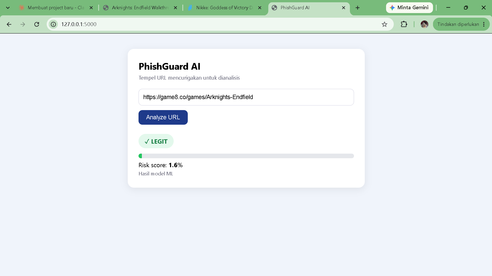
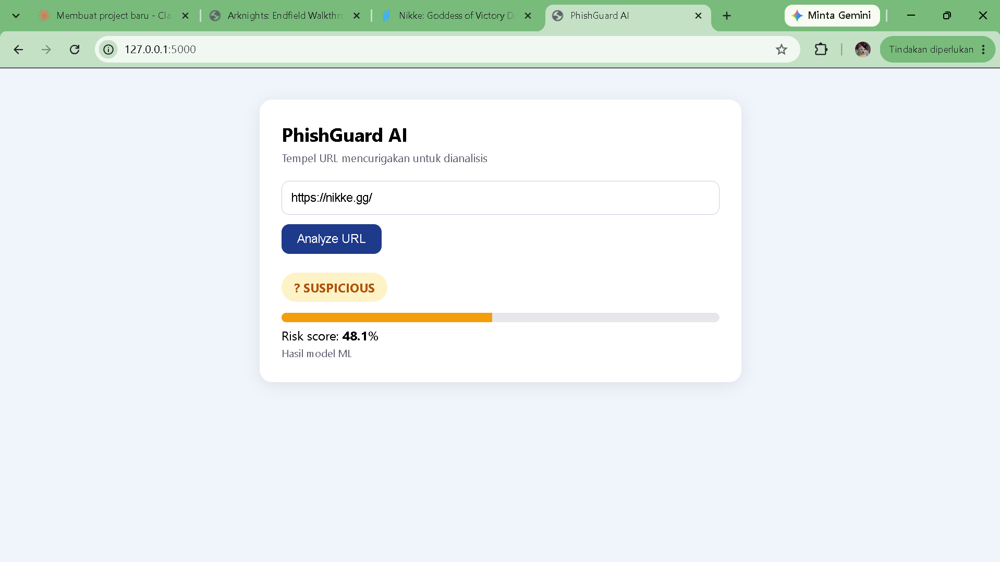
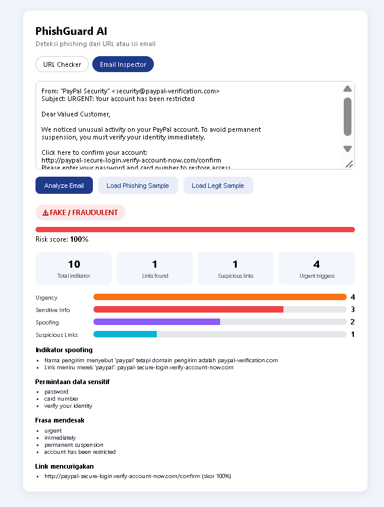

# PhishGuard AI

Sistem deteksi phishing untuk **URL** dan **isi email**, lengkap dengan demo web. Untuk URL, sistem memakai model machine learning. Untuk email, sistem menggabungkan analisis berbasis aturan dengan model URL tadi. Hasilnya berupa **skor risiko (0-100%)** dan label **LEGIT**, **SUSPICIOUS**, atau **FAKE / FRAUDULENT**.





## Fitur

- **URL Checker:** klasifikasi URL phishing dengan TF-IDF character n-gram + Logistic Regression
- **Email Inspector:** deteksi indikator urgensi, permintaan data sensitif, spoofing merek, dan link mencurigakan, dengan dashboard ringkasan
- Pendekatan hibrida: daftar domain tepercaya (allowlist) dicek dulu, sisanya dinilai model ML
- Tiga tingkat risiko (bukan sekadar biner) supaya kasus abu-abu tidak langsung divonis phishing
- Web demo sederhana (Flask) dengan endpoint `/analyze` dan `/analyze_email`

## Teknologi

Python, pandas, scikit-learn, joblib, Flask, HTML/CSS/JavaScript

## Dataset

- **Data phishing:** `phishing_site_urls.csv` (kolom `URL` dan `Label`). Setelah duplikat dibuang: 392.897 URL `good` dan 114.298 URL `bad`.
- **Daftar domain populer:** [Tranco top 1M](https://tranco-list.eu/). 100.000 domain teratas ditambahkan sebagai contoh "good" pada data latih. 20.000 domain berikutnya **tidak ikut training** dan dipakai khusus untuk mengukur false positive.

Dataset tidak disertakan di repositori ini.

## Cara kerja

### URL Checker

1. URL dinormalisasi (huruf kecil, skema `http://` atau `https://` dibuang agar cocok dengan format data latih).
2. Jika host URL sama dengan, atau subdomain dari, domain di daftar tepercaya, hasilnya langsung `LEGIT`.
3. Jika tidak, model menghitung peluang phishing dan diterjemahkan menjadi label:

| Skor risiko | Label |
|---|---|
| < 35 | LEGIT |
| 35 - 65 | SUSPICIOUS |
| >= 65 | FAKE / FRAUDULENT |

Batas 35 dan 65 adalah nilai awal dan bisa disesuaikan.

### Email Inspector

Teks email (termasuk baris `From:` dan `Subject:`) dianalisis dengan empat indikator:

| Indikator | Cara deteksi | Bobot |
|---|---|---|
| Urgency | Frasa mendesak berbahasa Inggris dan Indonesia (mis. "urgent", "immediately", "segera", "akan diblokir") | 8 poin per frasa, maksimal 4 frasa |
| Sensitive Info | Permintaan data sensitif (mis. "password", "OTP", "card number", "verify your identity") | 10 poin per frasa, maksimal 3 frasa |
| Spoofing | Nama atau domain pengirim menyebut sebuah merek padahal bukan domain resminya; link yang meniru merek | 15 poin per temuan, maksimal 2 temuan |
| Suspicious Links | Setiap link di email dinilai oleh model URL; skor 35 ke atas dianggap mencurigakan | 15 poin per link, maksimal 2 link |

Skor dijumlahkan dengan batas atas 100, lalu dipetakan ke label yang sama dengan URL Checker. Untuk skor rendah, tampilan email memakai teks "LOW RISK (tidak ada indikator)" karena sistem hanya bisa menyatakan tidak ada indikator yang ditemukan, bukan membuktikan email itu aman.

Hasil pada dua email contoh:

| Email contoh | Skor | Label |
|---|---|---|
| Email phishing meniru PayPal | 100 | FAKE / FRAUDULENT (10 indikator) |
| Notifikasi pesanan Tokopedia | 0 | LEGIT |

## Hasil dan evolusi model URL

Evaluasi pada 101.439 URL data uji (20% dari dataset asli, stratified).

| Model | Accuracy | F1 phishing | False positive pada 20.000 domain populer* | Recall phishing domain polos** |
|---|---|---|---|---|
| Fitur manual + Logistic Regression | 0.78 | 0.54 | - | - |
| Fitur manual + Random Forest | 0.87 | 0.73 | - | - |
| TF-IDF char n-gram + Logistic Regression (v1) | 0.98 | 0.95 | 70,0% | 95,4% |
| v1 + data domain populer Tranco (v2) | 0.98 | 0.95 | **1,6%** | 75,8% |

\* Domain populer di luar data latih, dalam bentuk domain polos.
\** URL phishing di data uji tanpa path (476 sampel), jadi angkanya kasar.

### Temuan penting

Model v1 terlihat sangat akurat (F1 0,95), tetapi ketika diuji pada domain populer yang asli, **70% di antaranya salah ditandai phishing**. Contohnya situs game `nikke.gg` dinilai phishing dengan skor 95%. Dugaan penyebabnya adalah pola dataset: URL "good" umumnya panjang dan berpath, sedangkan domain polos lebih sering berlabel "bad", sehingga model mempelajari bentuk URL, bukan niat situsnya.

Perbaikannya adalah menambahkan 100.000 domain populer sebagai contoh "good" pada data latih. Hasilnya, false positive turun dari 70,0% menjadi 1,6% tanpa menurunkan F1 pada data uji asli. `nikke.gg` turun ke skor 48,1% dan kini berlabel SUSPICIOUS.

Harga yang dibayar: recall phishing berbentuk domain polos turun dari 95,4% menjadi 75,8%. Angka 95,4% pada v1 sebagian besar "semu", karena v1 memang menandai hampir semua domain polos sebagai phishing, termasuk yang asli.

## Keterbatasan

**URL Checker**
- Model hanya melihat **teks URL**. Tidak ada analisis isi halaman, sertifikat, reputasi, maupun umur domain.
- Phishing berbentuk domain polos (misalnya typosquatting tanpa path) lebih sulit ditangkap: recall 75,8% pada sampel kecil.
- Allowlist bisa disalahgunakan pada layanan yang mengizinkan konten pengguna (misalnya halaman buatan pengguna di domain besar).
- Evaluasi memakai satu dataset publik, sehingga performa di dunia nyata bisa berbeda.

**Email Inspector**
- Berbasis aturan dan kata kunci: phishing yang tidak memakai frasa yang dikenal, tidak memuat link, atau berupa pesan singkat berbasis rekayasa sosial bisa lolos dengan skor rendah.
- Daftar frasa hanya mencakup bahasa Inggris dan Indonesia, dan daftar merek terbatas pada beberapa merek populer.
- Pencocokan merek memakai kata utuh, sehingga penulisan yang dimanipulasi (misalnya `paypa1`) tidak terdeteksi sebagai peniruan merek.
- Hanya teks biasa: belum memeriksa header email (SPF, DKIM, DMARC), lampiran, maupun perbedaan teks link dan tujuan link pada email HTML.
- Bobot skor ditentukan manual dan belum dikalibrasi dengan dataset email.

Proyek ini untuk pembelajaran dan bukan pengganti perangkat keamanan profesional.

## Struktur proyek

```
project 1/
├── app/
│   ├── app.py                # server Flask
│   └── templates/index.html  # antarmuka (tab URL dan Email)
├── data/                     # dataset (tidak di-commit)
├── docs/                     # screenshot untuk README
├── models/                   # model hasil training (tidak di-commit)
├── notebooks/
├── src/
│   ├── features.py           # ekstraksi fitur manual (eksperimen awal)
│   ├── train.py              # baseline: fitur manual + LR / Random Forest
│   ├── train_tfidf.py        # model v1
│   ├── train_tfidf_v2.py     # model v2 (+ data domain populer)
│   ├── predict.py            # allowlist + prediksi URL + label risiko
│   └── email_analysis.py     # analisis indikator email
└── requirements.txt
```

## Cara menjalankan

Contoh untuk Windows PowerShell, dari folder root proyek:

```powershell
python -m venv venv
.\venv\Scripts\Activate.ps1
pip install -r requirements.txt
```

Siapkan data: taruh `phishing_site_urls.csv` di folder `data\`, lalu unduh daftar Tranco:

```powershell
Invoke-WebRequest -Uri "https://tranco-list.eu/top-1m.csv.zip" -OutFile "data\top-1m.csv.zip"
Expand-Archive -Path "data\top-1m.csv.zip" -DestinationPath "data" -Force
```

Latih model (v1 dulu karena v2 membandingkan dirinya dengan v1), lalu jalankan demo:

```powershell
mkdir models
python src\train_tfidf.py
python src\train_tfidf_v2.py
python app\app.py
```

Buka `http://127.0.0.1:5000` di browser. Gunakan tab **URL Checker** atau **Email Inspector**. Analisis email juga bisa dicoba langsung dari terminal:

```powershell
python src\email_analysis.py
```

## Rencana pengembangan

- Pemeriksaan header email (SPF, DKIM, DMARC) dan deteksi perbedaan teks link dengan tujuan link pada email HTML
- Deteksi typosquatting terhadap merek populer (mis. `paypa1` vs `paypal`)
- Dataset email berlabel untuk melatih dan mengkalibrasi klasifikasi email, menggantikan bobot manual
- Penyesuaian batas skor berdasarkan kurva precision-recall
